# Rally de la Independencia AR

Juego de realidad aumentada para recorrer Dolores Hidalgo: radar, frío o caliente, trivia histórica, álbum coleccionable y modo demo. Construido con Flutter siguiendo TDD.

Materia: Desarrollo Móvil Integral, UTNG.
Autor: Aguilar Ortiz Gael Alejandro, grupo GTID241.

## Cómo ejecutarlo

```bash
flutter pub get
flutter test
flutter run
```

## Estructura

```
lib/
  dominio/        reglas del juego en Dart puro
  datos/          GPS, brújula, simuladores y almacenamiento
  presentacion/   ViewModel y pantallas
test/             pruebas por ronda
```

## Evidencias por ronda

### Ronda 0 · Taller
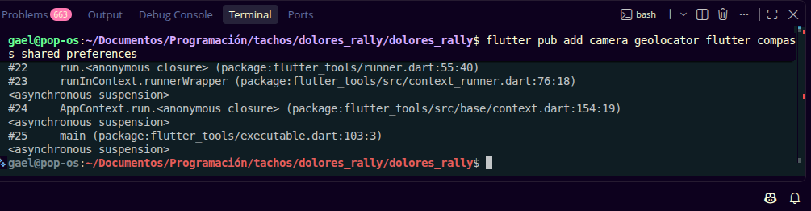

### Ronda 2 · Geometría (geo.dart)
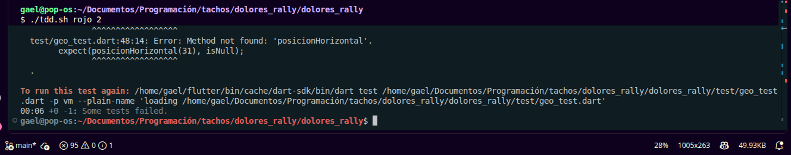
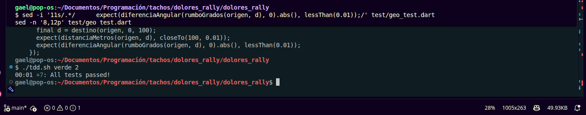

### Ronda 3 · Catálogo
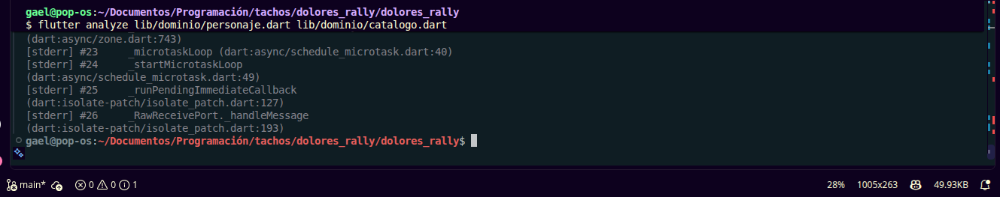

### Ronda 4 · Azar inyectado (aparicion.dart)
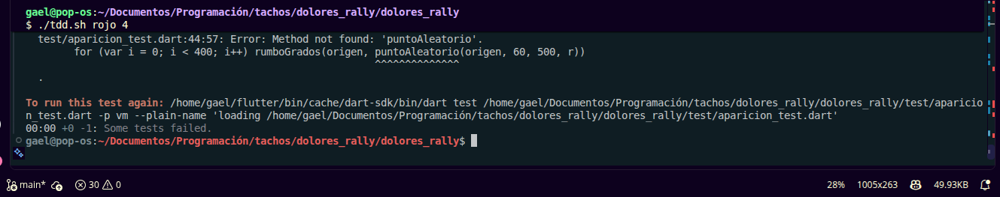
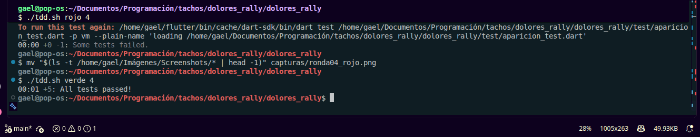

### Ronda 5 · Radar y temperatura (radar.dart)
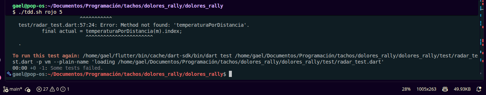
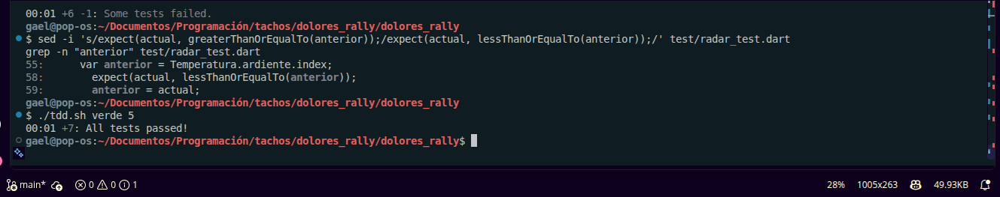

### Ronda 6 · Motor AR (motor_ar.dart)
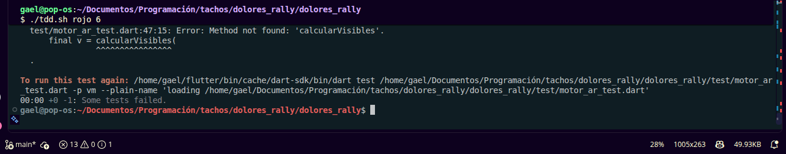
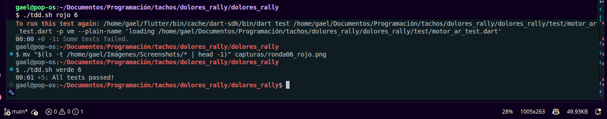

### Ronda 7 · Reglas del juego (partida.dart)
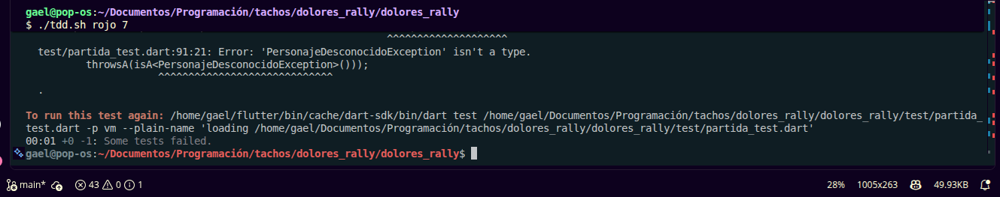
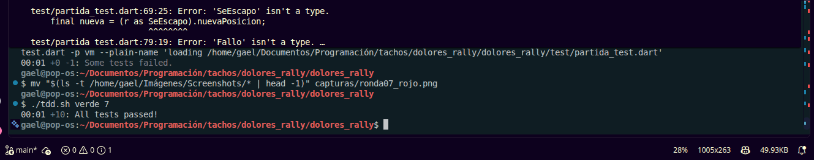

### Ronda 8 · Almacén
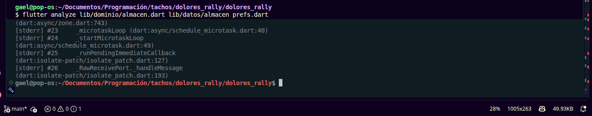

### Ronda 9 · Fuentes de posición y brújula
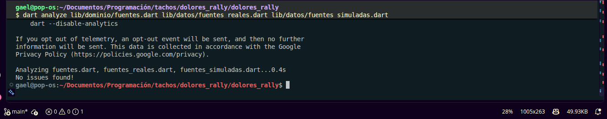

### Ronda 10 · ViewModel
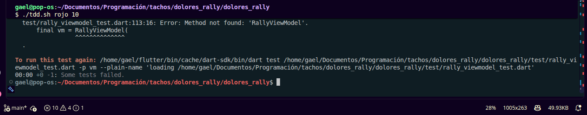
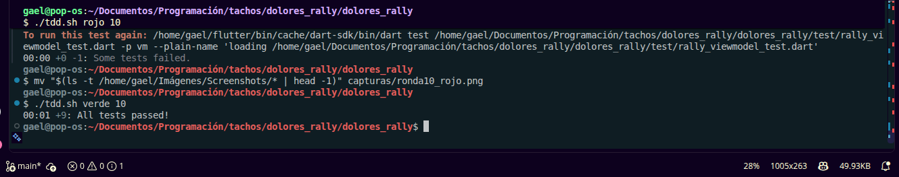

### Ronda 11 · Pantallas y modo demo
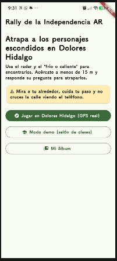
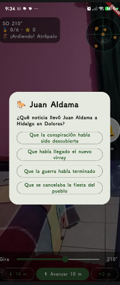

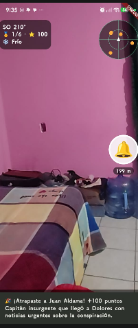

### Ronda 12 · Todas las pruebas
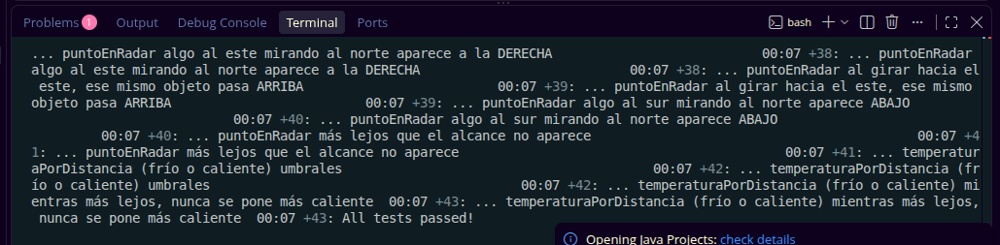
